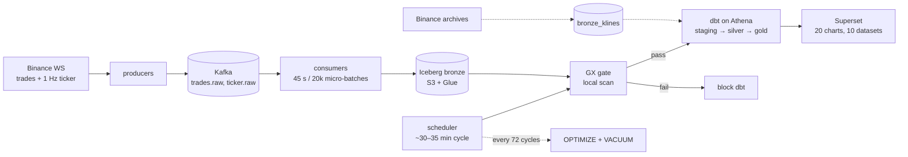

# tickstream

[](https://github.com/Danselem/tickstream/actions/workflows/ci.yml)
  
  


A real-time crypto lakehouse: Binance WebSocket trades and 1 Hz top-of-book
snapshots flow through Kafka into Iceberg on S3, are gated by Great Expectations,
and are modelled with dbt on Athena for Superset. Built to demonstrate idempotent
streaming, lakehouse maintenance, and analytics engineering — not trading.
Out of scope by design: Spark, Airflow, equities, trading logic, ML.

| Signal | Current |
|---|---|
| Live scope | 7 USDT pairs: BTC, ETH, SOL, ADA, DOGE, LINK, AVAX |
| Throughput | ~150–200 trades/s (~15M/day) + 1 Hz ticker per symbol |
| Freshness | Gold ≤ ~35 min (scheduler cadence); ticker ≤ ~1 min |
| Quality | 118 offline unit tests; GX gate; whole-table integrity every 72 cycles |
| dbt | 128 nodes: 14 models + 114 data tests; every column documented |
| Serving | 20 charts / 10 datasets across **Market** and **Pipeline health** |
| Cost | $3.40 for 16–24 Oct; ~$11–12/mo run-rate against a $20 budget alert |

## Architecture



Bronze holds raw trades and snapshots plus T+1 archive klines. The unified candle
view prefers live candles and falls back to the archive. Exact flow, failure
modes, and tradeoffs: [architecture](docs/architecture.md).

## Quickstart

**Prerequisites:** Docker Desktop, `uv`, OpenTofu ≥ 1.9, AWS CLI credentials
allowed to create the stack, and an email for the budget alert.

```bash
cp .env.example .env                    # fill in AWS + Superset values
openssl rand -hex 32                    # SUPERSET_SECRET_KEY
make install
make lint typecheck test                # offline; integration is opt-in
make infra-bootstrap                    # one-time state backend
make infra-plan ALERT_EMAIL=you@example.com
make infra-apply                        # explicit human approval required
# add a tickstream-pipeline access key to .env
make up                                 # dashboard at http://localhost:8088
```

**First run:** ticker data arrives within a minute or two; gold and the Market
charts populate after the first GX → dbt cycle (~30–35 min). For chart history,
stop the scheduler, run `make backfill FORCE=1`, then `make dbt-build`, and
restart it — full steps in the [runbook](docs/runbook.md#kline-backfill-history-for-charts-adr-026).
`make help` lists every target; `tofu destroy` requires approval.

## How it works

- **Ingest.** Two producers write `trades.raw` and `ticker.raw`; symbols map
  explicitly to partitions, and a silence watchdog forces reconnects
  ([ADR-025](docs/decisions.md#adr-025--treat-a-silent-websocket-as-dead-message-watchdog),
  [ADR-028](docs/decisions.md#adr-028--explicit-symbolpartition-routing-for-tradesraw)).
- **Bronze.** Consumers anti-join each batch's day×symbol scope and append only
  new keys. Offsets commit after Iceberg; the next window starts after the whole
  flush ([ADR-013](docs/decisions.md#adr-013--bronze-write-path-pruned-scan-merge-transient-retry-s3-timeouts),
  [ADR-030](docs/decisions.md#adr-030--start-the-batch-window-after-the-whole-flush)).
- **Quality.** GX scans locally for free; a failed suite blocks dbt. A
  whole-table integrity check runs every 72 cycles and also blocks on duplicates
  ([ADR-002](docs/decisions.md#adr-002--great-expectations-validates-a-local-pyiceberg-scan),
  [ADR-016](docs/decisions.md#adr-016--whole-table-integrity-check-on-the-maintenance-cadence)).
- **Transform.** dbt builds incremental, target-anchored candles, VWAP,
  volatility, summaries, and microstructure; archive klines fill history
  ([ADR-024](docs/decisions.md#adr-024--incremental-windows-anchor-on-the-target-with-overridable-lookbacks),
  [ADR-026](docs/decisions.md#adr-026--archive-1m-klines-backfill-for-chart-history-bronze_klines)).
- **Serve and maintain.** Superset is provisioned entirely through its REST API;
  Athena `OPTIMIZE` + `VACUUM` run every 72 cycles
  ([ADR-011](docs/decisions.md#adr-011--superset-dashboard-as-code-via-a-rest-provision-script)).

## Documentation

| Document | Contents |
|---|---|
| [Architecture](docs/architecture.md) | End-to-end flow, delivery semantics, failure modes |
| [Data model](docs/data-model.md) | Tables, keys, partitions, lineage, retention |
| [Testing](docs/testing.md) | Test matrix, evidence, CI scope, known gaps |
| [ADRs](docs/decisions.md) | 30 decisions + the ADR-012a addendum |
| [Runbook](docs/runbook.md) | Setup, incidents, recovery, backfills, teardown |
| [Cost](docs/cost.md) | Guardrails, measured bills, run-rate, recommendations |
| [Build plan](plan.md) | Historical phases and Brief §11 definition of done |

## Lessons learned

Every row was a real incident; the full set is in
[architecture](docs/architecture.md#failure-modes-seen-in-practice-and-the-fixes).

| Symptom | Root cause | Fix |
|---|---|---|
| 440k lag, one partition held 74% of trades | Kafka murmur2 hash sent 6 of 7 symbols to partition 0 | Explicit symbol→partition map; no topic change or offset reset (ADR-028) |
| 15.8k duplicate keys after rebalance | Each replica cached its own Iceberg handle and replayed another replica's batch | `refresh()` before anti-join, cooperative-sticky, commit-on-revoke (ADR-015) |
| One-row batches forever | Batch window reset before the write/commit or metrics append | Reset at the end of `_flush()` (ADR-014/030) |

## What I'd change at scale

- **Kafka:** 3+ brokers, RF=3, more partitions, a consumer group with >1 member.
- **Lakehouse:** S3 Tables auto-compaction or a streaming merge; smaller batches for latency.
- **Orchestration:** Airflow or Dagster once the DAG grows beyond one scheduler loop.
- **Serving and security:** Postgres metadata + caching; IAM roles instead of user keys.

## Known gaps

- A host stop/sleep pauses all services. Trades and candles recover from Binance
  archives T+1; ticker history is unrecoverable.
- Gold freshness follows the scheduler (~30–35 min); the dashboard is
  near-real-time, not streaming.
- CI covers lint, types, and offline unit tests only. dbt, GX, and Kafka
  integration checks need live infrastructure. S3 lifecycle rules are still
  pending.

## License

MIT © 2026 Daniel Egbo
