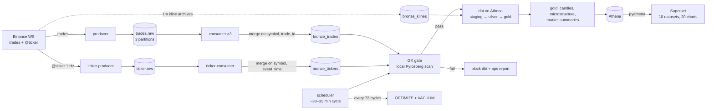

# tickstream

Real-time crypto streaming pipeline (portfolio project): live Binance trades and
1 Hz top-of-book snapshots → Kafka → Apache Iceberg on AWS S3 → dbt models on
Athena → Superset dashboards, with Great Expectations quality gates at every
step.

**Status (Oct 2026): end to end live** — 7 coins (BTC, ETH, SOL, ADA, DOGE, LINK,
AVAX), a 1 Hz `@ticker` stream for quoted spread/depth, GX-gated dbt builds, a
published 20-chart Superset dashboard, 118 unit tests, 128 dbt nodes
(14 models + 114 data tests), 30 ADRs (+ the ADR-012a addendum); ~$3.4 AWS spend
for 16–24 Oct against a $20 budget alert.

## What this demonstrates

- **Safe at-least-once processing.** Idempotent writes at every layer, offsets
  committed only after Iceberg, and replay/rebalance tests that assert zero
  duplicates.
- **Streaming + lakehouse mechanics.** Kafka micro-batches, PyIceberg dedup
  commits, partition pruning, small-file compaction and snapshot cleanup.
- **Late and out-of-order data.** Event time and ingest time are both kept;
  silver uses lookbacks and target-anchored windows so late trades self-correct.
- **Operational maturity.** Reconnect/backoff, a silent-WebSocket watchdog, GX
  gates, whole-table integrity checks, structured logs, lag/freshness metrics,
  and a runbook for every incident that actually happened.
- **Analytics engineering.** dbt tests and column docs, a dashboard defined as
  code, and a cost model backed by measured AWS bills.

## Stack

Python 3.12 · uv · Docker Compose · Apache Kafka (KRaft, 1 broker) · PyIceberg ·
AWS S3 + Glue + Athena · dbt (dbt-athena) · Great Expectations · OpenTofu ·
Apache Superset. Out of scope by design: Spark, Airflow, trading logic, ML.

## Quickstart

Prerequisites: Docker Desktop, `uv`, OpenTofu ≥ 1.9, AWS CLI with credentials
allowed to create the stack, and an email for the budget alert.

```bash
cp .env.example .env        # AWS keys/bucket/region, Superset secret + admin
openssl rand -hex 32        # generate SUPERSET_SECRET_KEY

make install                # uv sync
make lint typecheck test    # tests are offline; integration is opt-in
make infra-bootstrap        # one-time tofu state backend (S3 + DynamoDB)
make infra-plan ALERT_EMAIL=you@example.com   # review; budget alert first
make infra-apply            # explicit human approval required
make up                     # all services; dashboard at http://localhost:8088
```

`make help` lists everything: `quality`, `dbt-build`, `maintenance`, `backfill`,
`integrity`, `health`, `compact`, `superset`, `logs`, infra targets.

**First run.** `make up` starts both producers, the consumers, the scheduler and
Superset. The dashboard is provisioned at boot; ticker data starts landing
within a minute or two, while gold tables and Market charts populate after the
first GX → dbt cycle (~30–35 min at current volume). For chart history, stop the
scheduler, run `make backfill FORCE=1`, then `make dbt-build`, and restart it — see the
[runbook](docs/runbook.md#kline-backfill-history-for-charts-adr-026). Today's UTC
kline is only in the archive tomorrow (T+1). `tofu destroy` requires approval;
`make down -v` removes local Kafka/Superset volumes.

## Architecture



Binance archives supply 1m klines for history (`bronze_klines`); the unified
candle view prefers live candles per minute and falls back to klines. See
[architecture](docs/architecture.md) for the full flow and
[decisions](docs/decisions.md) for the ADR index.

## How it works

- **Ingest.** Two WebSocket producers (one per stream family) write `trades.raw`
  and `ticker.raw`, keyed by symbol. Trades use explicit symbol→partition
  routing ([ADR-028](docs/decisions.md#adr-028--explicit-symbolpartition-routing-for-tradesraw));
  the default hash put 74% of volume on one partition.
- **Bronze.** Consumers micro-batch (45 s / 20k rows), prune the batch's
  day×symbol partitions, anti-join keys in Arrow, and append only new rows.
  Offsets commit only after the Iceberg write; the next batch window starts
  after the whole flush — write, commit and the best-effort metrics append
  ([ADR-013](docs/decisions.md#adr-013--bronze-write-path-pruned-scan-merge-transient-retry-s3-timeouts)/[014](docs/decisions.md#adr-014--consumer-scale-out-to-3-replicas--batching-window-fix)/[030](docs/decisions.md#adr-030--start-the-batch-window-after-the-whole-flush)).
  Trades dedupe on `(symbol, trade_id)`, tickers on `(symbol, event_time)`.
- **Quality.** GX validates a local PyIceberg scan (zero Athena spend) for trades
  and tickers; a failing suite blocks dbt and records the failure in
  `quality_results` ([ADR-002](docs/decisions.md#adr-002--great-expectations-validates-a-local-pyiceberg-scan)/[008](docs/decisions.md#adr-008--ops-tables-live-in-the-tickstream-glue-database)).
  Every 72 cycles the scheduler also runs a whole-table duplicate check and lake
  health (row counts, per-symbol freshness); duplicates block dbt
  ([ADR-016](docs/decisions.md#adr-016--whole-table-integrity-check-on-the-maintenance-cadence)/[021](docs/decisions.md#adr-021--lake-level-health-per-layer-row-counts-and-per-symbol-freshness)).
- **Transform.** dbt on Athena: staging views → silver merges → gold 1m OHLC,
  VWAP, notional, trade count, volatility, daily/hourly summaries, and 1-minute
  microstructure (spread bps, mid, displayed depth, imbalance). The
  `gold_candles_1m_unified` view merges live candles with archive klines
  ([ADR-026](docs/decisions.md#adr-026--archive-1m-klines-backfill-for-chart-history-bronze_klines)).
  Incremental windows are target-anchored and overridable
  ([ADR-024](docs/decisions.md#adr-024--incremental-windows-anchor-on-the-target-with-overridable-lookbacks)).
- **Serve.** Superset 6, provisioned entirely through its REST API: 10 datasets
  and 20 charts across **Market** and **Pipeline health**, with native Symbol
  (BTC default) and Time filters and 24 h detail / 30 d trend windows
  ([ADR-018](docs/decisions.md#adr-018--dashboard-readability-explicit-labels-legends-and-stable-tab-ids)/[020](docs/decisions.md#adr-020--market-overview--native-dashboard-filters)/[022](docs/decisions.md#adr-022--trailing-time-windows-for-provisioned-charts-now-nd--now)/[027](docs/decisions.md#adr-027--readable-default-view-btc-24-h-detail--30-d-trend)).
- **Maintain.** A ~30–35 min cycle (quality ~1 min + dbt ~20–23 min + 10 min
  sleep); every 72 cycles (~1.5–2 days) it runs Athena `OPTIMIZE` + `VACUUM`
  ([ADR-007](docs/decisions.md#adr-007--one-micro-batch-commit--one-iceberg-snapshotfile-for-now)).

All timestamps are UTC; event time and ingest time are both kept.

## Data model

| Layer | Table(s) | Grain / key | Purpose |
|---|---|---|---|
| Bronze | `bronze_trades` | one row per trade; dedupe `(symbol, trade_id)`; partitions day + symbol | Raw live trades |
| Bronze | `bronze_tickers` | 1 Hz snapshot; dedupe `(symbol, event_time)`; partitions day + symbol | Quoted spread/depth |
| Bronze | `bronze_klines` | one row per minute; `(symbol, open_time)`; partition symbol | Archive chart history |
| Silver | `silver_trades`, `silver_tickers`, `silver_klines` | deduped/typed; trades/tickers use 2 h lookbacks | Staging for gold |
| Gold | `gold_candles_1m` | `(symbol, candle_start)` | OHLC, VWAP, notional, volatility |
| Gold | `gold_candles_1m_hist`, `gold_candles_1m_unified` | per minute, live wins | 24 h detail + 30 d trend |
| Gold | `gold_market_summary_daily`, `_hourly` | `(symbol, window_start)` | Business summaries |
| Gold | `gold_market_microstructure_1m` | `(symbol, minute)` | Spread, mid, depth, imbalance |
| Ops | `quality_results`, `pipeline_metrics`, `integrity_results`, `layer_counts`, `symbol_freshness` | append-only | Gates, lag, integrity, health |

Bronze is raw event data (no enrichment); "idempotent" means a dedup commit, not
a mutation of the facts. Silver re-dedupes as defence in depth.

## Testing and observability

```bash
make test                                      # 118 unit tests, offline
RUN_KAFKA_TESTS=1 uv run pytest -m integration # live Kafka roundtrip (opt-in)
make dbt-build                                 # 128 nodes in Athena
```

- Replay and rebalance tests assert zero duplicate bronze keys; the GX and
  whole-table checks are tested for blocking dbt on failure.
- Structured JSON logs cover lag, batch size, rows appended/skipped, commit time,
  freshness and WebSocket throughput.
- The **Pipeline health** tab exposes lag, batch rows, quality runs, integrity,
  rows per layer and per-symbol freshness; the same facts are queryable in
  Athena.
- GX and integrity scan locally, so quality adds `$0` Athena spend.

### Verification highlights

- Restart + SIGKILL mid-stream, and a live 3→2→3 rebalance: 0 duplicates.
- GX failure injection blocks dbt (exit 1, window not advanced); integrity
  duplicates also block it ([ADR-016](docs/decisions.md#adr-016--whole-table-integrity-check-on-the-maintenance-cadence)).
- 20k-row stale replay: 2 appended, 19,998 skipped.
- 846,720 archive kline rows (7 coins × Aug 1–Oct 23), checksum-verified.
- Kafka lag after the partition fix: 440k → ~0; ticker lag bounded (~100–500)
  after the metrics-ordering fix ([ADR-030](docs/decisions.md#adr-030--start-the-batch-window-after-the-whole-flush)).
- Dashboard: 20 charts / 10 datasets; spread and imbalance scoped by the Symbol
  filter; XRP excluded from filter values but still queryable.

## Cost (16–24 Oct actuals)

S3 ≈ **$3.28** · Athena ≈ **$0.12** · Glue ≈ $0 · budget alert $20/mo. The
bucket held **8.9 GB / 59.7k objects** before maintenance and **6.9 GB /
55.8k objects** after `OPTIMIZE` + `VACUUM`. Storage is cents; requests from
small files dominate, and this window included recovery/backfill work. Run-rate
is roughly **$10–12/mo** at the current volume. GX and integrity run locally, so
quality adds zero Athena spend. Details and the small-file plan:
[cost](docs/cost.md).

## Key design decisions

- At-least-once delivery with idempotent bronze merges; offsets only after the
  write ([ADR-013](docs/decisions.md#adr-013--bronze-write-path-pruned-scan-merge-transient-retry-s3-timeouts)/[015](docs/decisions.md#adr-015--cross-replica-duplication-on-rebalance-refresh-before-scan--revoke-commit)).
- GX on a local Iceberg scan, not Athena: correctness for free
  ([ADR-002](docs/decisions.md#adr-002--great-expectations-validates-a-local-pyiceberg-scan)).
- Separate ops tables in the same Glue database; health checks never block data
  on the first failure ([ADR-008](docs/decisions.md#adr-008--ops-tables-live-in-the-tickstream-glue-database)/[021](docs/decisions.md#adr-021--lake-level-health-per-layer-row-counts-and-per-symbol-freshness)).
- Archive backfill + unified candle view so charts keep history and prefer live
  data for overlapping minutes ([ADR-026](docs/decisions.md#adr-026--archive-1m-klines-backfill-for-chart-history-bronze_klines)/[027](docs/decisions.md#adr-027--readable-default-view-btc-24-h-detail--30-d-trend)).
- Explicit symbol→partition routing and a separate ticker stream to isolate the
  hot path ([ADR-028](docs/decisions.md#adr-028--explicit-symbolpartition-routing-for-tradesraw)/[029](docs/decisions.md#adr-029--separate-ticker-stream-for-top-of-book-microstructure)).

The full list, with context and consequences, is the
[ADR index](docs/decisions.md).

## Lessons learned

Each row was a real incident, not a hypothetical.

| Symptom | Root cause | Fix |
|---|---|---|
| One partition held 74% of trades; lag grew to 440k | Kafka murmur2 hashing skewed 6 of 7 symbols to partition 0 | Explicit `TICKSTREAM_SYMBOL_PARTITIONS` map; no topic change or offset reset (ADR-028) |
| 15.8k duplicate keys after a rebalance | Each replica cached its own Iceberg table handle and replayed another replica's batch | `refresh()` before the anti-join, cooperative-sticky, commit-on-revoke, plus the integrity backstop (ADR-015/016) |
| Stream stayed open but delivered no trades for hours | Keepalive only detects a dead TCP path; per-message silence was invisible | `asyncio.wait_for` watchdog → reconnect within ~1 min (ADR-025) |
| One-row batches forever, lag unbounded | The 45 s window reset at the start of the flush (then, later, before a ~40 s metrics append) | No timer in `drain()`; reset after write + commit + metrics (ADR-014/030) |
| dbt MERGEs timed out at the Glue catalog | Rewriting unchanged rows on every 2 h lookback | `update_condition` on immutable trade facts (ADR-009) |
| Four-day gap after a host sleep | Docker daemon stopped; Kafka volume survived, producers reconnected | Backfill klines from Binance archives, rebuild dbt; ticker history is unrecoverable (runbook) |
| 8.9 GB in 59.7k objects after downtime | Per-batch commits accumulated small files while the scheduler was stopped | `OPTIMIZE` + `VACUUM` → 6.9 GB in 55.8k objects; lifecycle rules still pending (cost) |

## What I'd change at scale

- Kafka: 3+ brokers, RF=3, more partitions; consumer group with >1 member.
- Bronze: S3 Tables auto-compaction or Flink-style streaming merge; smaller
  `BATCH_MAX_ROWS` if single-batch latency matters more than file count.
- Orchestration: Airflow/Dagster over the bespoke scheduler loop once DAGs grow.
- Serving: Superset with Postgres metadata + caching; Athena provisioned capacity
  if dashboards go concurrent.
- Schema: full schema-evolution drills (add-nullable-column end to end).
- Multi-region/auth: IAM roles for service accounts instead of user keys.

## Known gaps

- A host stop/sleep (Docker daemon down) pauses all services. Trades and candles
  recover from Binance archives T+1 (`make backfill`); ticker history cannot be
  replayed — Binance publishes no historical top-of-book snapshots.
- Gold freshness follows the scheduler cadence (up to ~30–35 min); the 24 h
  chart is complete via the unified view once klines are backfilled.
- `pipeline_metrics` compaction can fail while four consumers commit to it;
  retry during a quiet window (data is unaffected).

## Repo map

```
src/pipeline/{producer,consumer,common,quality,scheduler,superset,backfill}/  typed Python
dbt/models/{staging,silver,gold}/   views/incremental merges + tests + docs
quality/suites/                     GX suite snapshots (reports/ gitignored)
superset/                           image + config + bootstrap + REST provisioning
infra/                              OpenTofu: budget alert first, then bucket/Glue/Athena/IAM
tests/                              pytest: 118 unit + opt-in Kafka integration
docs/                               architecture, decisions (30 ADRs + 012a), cost, runbook
```

Ops procedures and incident fixes: [runbook](docs/runbook.md). Original scope and
definition of done: [Brief](Brief.md) and the [build plan](plan.md).

## License

MIT © 2026 Daniel Egbo
