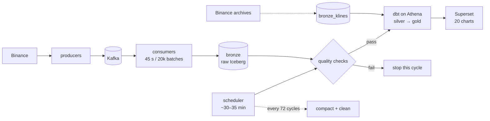

# tickstream

[](https://github.com/Danselem/tickstream/actions/workflows/ci.yml)
  
  


Live Binance trades and 1-second price quotes move through Kafka (a replayable
message queue) into raw, versioned tables stored on S3. A scheduled quality gate
checks the newest data; dbt turns raw data into minute-level tables, and Superset
serves the dashboard. The write path is replay-safe: if the same trade
arrives twice, it is stored once.

This is a data-engineering portfolio project, not a trading system. It shows the
full path — ingestion, lakehouse maintenance, data quality, analytics engineering,
and serving — with the trade-offs written down. The table format is Apache
Iceberg; technical terms link to the [glossary](docs/glossary.md).

| Signal | Current |
|---|---|
| Live scope | 7 USDT pairs: BTC, ETH, SOL, ADA, DOGE, LINK, AVAX |
| Throughput | ~150–200 trades/s (~15M/day) + 1 Hz quote per symbol |
| Freshness | Gold ≤ ~35 min (scheduler cadence); quotes ≤ ~1 min |
| Quality | 118 offline tests; a Great Expectations gate blocks the scheduled SQL build |
| dbt | 128 nodes: 14 SQL models + 114 data tests; core columns documented |
| Serving | 20 charts / 10 datasets across **Market** and **Pipeline health** |
| Cost | $3.40 for 16–24 Oct; ~$11–12/mo run-rate against a $20 alert |

## Start here

- **Two-minute overview:** this page → [architecture short version](docs/architecture.md) → [cost](docs/cost.md).
- **Engineer new to Kafka/Iceberg:** [architecture](docs/architecture.md#one-trades-journey) → [data model](docs/data-model.md) → [testing](docs/testing.md) → [ADRs](docs/decisions.md).
- **Operator:** [runbook](docs/runbook.md). Commands and expected results are together.
- **Unfamiliar term:** [glossary](docs/glossary.md).

## Architecture



Bronze holds raw trades and quotes plus T+1 archive klines. The unified candle view
prefers live candles and falls back to the archive. Quality checks use Great
Expectations; compaction uses Athena `OPTIMIZE` + `VACUUM`.

Kafka exists so a consumer crash does not lose data. Bronze exists so raw events
can be reprocessed without asking Binance again. The gate exists so bad data does
not become a chart. Exact flow, failure modes, and trade-offs:
[architecture](docs/architecture.md).

## Quickstart

**Prerequisites:** Docker Desktop, `uv`, OpenTofu ≥ 1.9, AWS CLI credentials
allowed to create the stack, and an email for the budget alert. Infrastructure
commands use your shell's AWS CLI credentials; the pipeline key goes in `.env`
after apply.

```bash
cp .env.example .env                    # fill in region, bucket, Superset values
openssl rand -hex 32                    # SUPERSET_SECRET_KEY
make install
make lint typecheck test                # offline; integration is opt-in
make infra-bootstrap                    # one-time state backend
make infra-plan ALERT_EMAIL=you@example.com
make infra-apply                        # explicit human approval required
# add AWS_ACCESS_KEY_ID and AWS_SECRET_ACCESS_KEY for tickstream-pipeline (runbook step 7)
make up                                 # dashboard at http://localhost:8088
```

**First run:** quotes arrive within a minute or two; gold and the Market charts
populate after the first quality → dbt cycle (~30–35 min). For chart history, stop
the scheduler, run `make backfill FORCE=1`, then `make dbt-build`, and restart it.
Full steps: [runbook](docs/runbook.md#kline-backfill-history-for-charts-adr-026).
`make help` lists every target; `tofu destroy` requires approval.

## How it works

- **Ingest.** Two producers write trades and quotes to Kafka. Each symbol is
  routed to a fixed partition (an ordered slice of the stream), and a silence
  watchdog forces a reconnect when the socket stays open without messages
  ([ADR-025](docs/decisions.md#adr-025--treat-a-silent-websocket-as-dead-message-watchdog),
  [ADR-028](docs/decisions.md#adr-028--explicit-symbolpartition-routing-for-tradesraw)).
- **Land.** Consumers group events into 45-second or 20k-row batches. They scan
  only the relevant day/symbol data, append trade keys that are not already
  present, and save their Kafka position (offset) only after the Iceberg write
  succeeds
  ([ADR-013](docs/decisions.md#adr-013--bronze-write-path-pruned-scan-merge-transient-retry-s3-timeouts),
  [ADR-030](docs/decisions.md#adr-030--start-the-batch-window-after-the-whole-flush)).
- **Check.** Great Expectations scans the recent window locally, so the check adds
  no Athena spend. A failed suite stops the scheduled dbt build. A whole-table
  duplicate check runs every 72 cycles as a backstop
  ([ADR-002](docs/decisions.md#adr-002--great-expectations-validates-a-local-pyiceberg-scan),
  [ADR-016](docs/decisions.md#adr-016--whole-table-integrity-check-on-the-maintenance-cadence)).
  The scheduler runs GX first; `make dbt-build` alone skips GX, so run
  `make quality` first for a manual live build.
- **Model.** dbt builds incremental, target-anchored candles, VWAP, volatility,
  summaries, and top-of-book microstructure. Windows start from the newest row in
  the target, so a skipped run catches up instead of leaving a hole
  ([ADR-024](docs/decisions.md#adr-024--incremental-windows-anchor-on-the-target-with-overridable-lookbacks),
  [ADR-026](docs/decisions.md#adr-026--archive-1m-klines-backfill-for-chart-history-bronze_klines)).
- **Serve and maintain.** Superset is provisioned through its REST API, so the
  dashboard is reproducible. `OPTIMIZE` and `VACUUM` run every 72 cycles
  ([ADR-011](docs/decisions.md#adr-011--superset-dashboard-as-code-via-a-rest-provision-script)).

## Documentation

| Document | Contents |
|---|---|
| [Architecture](docs/architecture.md) | End-to-end flow, one trade's journey, guarantees, failure modes |
| [Data model](docs/data-model.md) | Tables, fields, keys, partitions, example queries, retention |
| [Testing](docs/testing.md) | What is proven, commands, evidence, CI scope, gaps |
| [ADRs](docs/decisions.md) | 30 decisions + `ADR-012a`, why and consequences |
| [Runbook](docs/runbook.md) | Setup, triage, recovery, backfill, teardown |
| [Cost](docs/cost.md) | Cost drivers, measured bills, guardrails, projection |
| [Glossary](docs/glossary.md) | Plain definitions for technical terms |
| [Brief](Brief.md) | Current scope, requirements, and definition of done |
| [Build plan](plan.md) | As-built record, component map, phases, remaining risks |

## Lessons learned

Every row was a real incident; the full set is in
[architecture](docs/architecture.md#failure-modes-seen-in-practice-and-the-fixes).

| Symptom | Root cause | Fix |
|---|---|---|
| 440k lag; partition 0 held 6 of 7 symbols | Kafka's default hash clustered symbols; BTC+ETH alone were ~74% of trades | Explicit symbol→partition map; no topic change or offset reset (ADR-028) |
| 15.8k duplicate keys after rebalance | Each replica cached its own Iceberg handle and replayed another replica's batch | Refresh before the scan, cooperative-sticky assignment, commit on revoke (ADR-015) |
| One-row batches forever | Batch window reset before the write/commit or before a slow metrics append | Reset at the very end of the flush (ADR-014/030) |

## What I'd change at scale

- **Kafka:** 3+ brokers, RF=3, more partitions, a consumer group with more members.
- **Lakehouse:** S3 Tables auto-compaction or a streaming merge; smaller batches
  for lower latency.
- **Orchestration:** Airflow or Dagster once the workflow grows beyond one loop.
- **Serving and security:** Postgres metadata + query caching; IAM roles instead of
  a user access key.

## Known gaps

- A host stop or sleep pauses all services. Kafka replays messages it already
  accepted after a restart. Candles can be rebuilt from Binance's T+1 archive.
  Trades and quotes from the paused period were never produced and are lost;
  quote history has no archive at all.
- Gold freshness follows the scheduler (~30–35 min); this is near-real-time, not a
  streaming dashboard.
- CI covers lint, types, and offline unit tests only. dbt, GX, and Kafka
  integration checks need live infrastructure.
- S3 expiration and tiering rules for Athena results and old bronze data are still
  pending; only abort-incomplete-upload is configured.

## License

MIT © 2026 Daniel Egbo
