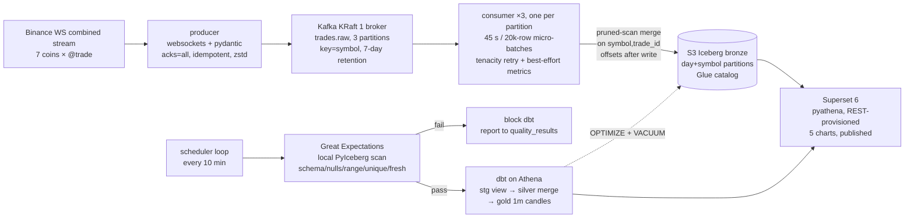

# Architecture

## Data flow

1. **Produce.** One asyncio producer holds the Binance combined stream
   (`<coin>@trade` × 7, lowercase) on the market-data mirror, validates each
   payload with pydantic (`TradeEvent`: symbol, trade_id, Decimal price/qty,
   UTC event + ingest time, buyer-maker flag), stamps ingest time, and produces
   with `acks=all`, idempotence, zstd, keyed by symbol. Reconnects with
   exponential backoff + jitter; SIGTERM flushes.
2. **Consume.** Three consumer replicas (`bronze-writer` group, manual commits,
   earliest) — one per `trades.raw` partition, keyed by symbol so each symbol is
   owned by exactly one replica. Each batches 45 s / 20k rows, converts to
   Arrow, merges, appends, then commits offsets. The batch window starts *after*
   a flush (not before), so a slow write cannot shrink the next batch (ADR-014).
   Lag, batch size, freshness logged per cycle and appended to
   `tickstream.pipeline_metrics` after the commit (gap-not-dup).
3. **Bronze.** Raw trade facts, partitioned by day + symbol, format v2. Merge =
   scan the batch's day×symbol scope (manifest pruning), Arrow anti-join on
   `(symbol, trade_id)`, append new rows only; full replays append nothing.
4. **Quality.** GX checkpoint over `last_success − 5 min overlap` window:
   required columns, no nulls in keys, `price/qty > 0`, `symbol:trade_id`
   uniqueness, freshness ≤ 300 s, row count ≥ 1. JSON report to
   `quality/reports/` + row to `tickstream.quality_results`. Failure → nonzero
   exit → scheduler skips dbt (and doesn't advance the window).
5. **Models.** dbt on Athena engine v3: `stg_trades` view → `silver_trades`
   (dedup `row_number()`, 2 h lookback, `update_condition` so identical rows
   skip rewrites) → `gold_candles_1m` (OHLC/volume/VWAP/trade_count/volatility,
   30-min recompute). 30+ tests, all columns documented.
6. **Serve.** Superset 6 (derived image + `pyathena[pandas]`, SQLite metadata on
   a volume) provisioned by a REST script: Athena database, 3 datasets
   (gold + 2 ops tables, never bronze), 5 charts (price/volume/volatility per
   symbol via groupby, lag, health table), one published dashboard.
7. **Maintain.** Every N scheduler cycles (and via `make maintenance`): Athena
   `OPTIMIZE … REWRITE DATA USING BIN_PACK` + `VACUUM` on bronze/silver/gold.

## Delivery semantics

At-least-once from Kafka; idempotency at every layer: bronze merge keys,
silver `row_number()` + merge keys, gold candle keys, MERGE
`update_condition`s. Offsets commit only after the Iceberg write; a crash
replays into upserts/appends that absorb duplicates (verified: restart,
SIGKILL, 20k replay batch → 2 appended / 19,998 skipped).

## Failure modes seen in practice (and the fixes)

- **S3 socket timeouts vs short pyarrow defaults** → crash/rebalance livelock.
  Fixed with tenacity retry (transient-only classification), raised
  `s3.connect/request-timeout` (15/60 s), `max.poll.interval.ms` 10 min.
- **`table.upsert` O(table) per batch** → replaced with pruned-scan merge
  (ADR-013). Lesson: benchmark the write path at 10× expected scale early.
- **Self-perpetuating 1-row batches** → the batch window reset at the *start*
  of the flush; once a flush outran the 45 s interval the next window was
  already expired and every batch flushed at one message. Looked like a stuck
  client but was control flow. Fixed by starting the window after the flush
  (ADR-014); regression-tested.
- **Kafka single-broker SPOF** → broker SIGKILLed during a 4-day host outage;
  volume-held data survived, ~1M backlog drained at ~20k/batch on restart.
  Accepted for MVP (ADR: multi-broker deferred), documented here instead.
- **Glue `UpdateTable` timeouts on big MERGE rewrites** → dbt
  `update_condition` (immutable-event pattern, ADR-009).
- **IAM least-privilege gaps found by exercising, not by review**:
  `glue:GetTableVersions` (dbt), `athena:GetTableMetadata`/`ListDatabases`
  datacatalog-scoped (Superset), PyAthena's lowercase `awsdatacatalog` default
  vs case-sensitive evaluation (pinned `catalog_name=AwsDataCatalog`).
- **Superset 6 integration**: config module replaces defaults (`from
  superset.config import *`), venv without pip, JWT still needs CSRF
  cookie+header (ADR-011/012).
