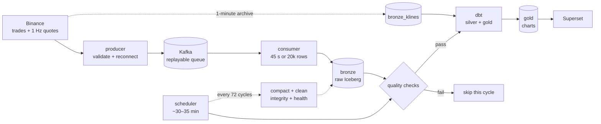

# Architecture

**What this answers:** how one Binance message becomes a chart, what prevents
data loss or duplication, and what happens when a component fails.

**Short version:** Binance pushes trades and quotes to a producer. The producer
writes them to Kafka, a queue that can replay messages. A consumer groups messages
into batches and writes them to Iceberg tables on S3. A scheduler checks the new
data, runs dbt models on Athena, and refreshes the tables Superset reads.

Technical terms are defined in the [glossary](glossary.md).

## The simple view

Bronze keeps raw facts (trades, quotes, archive candles). Silver deduplicates and
types them. Gold answers
chart questions. The kline archive fills gaps in candle history; it does not
restore trades or quotes.

## One trade's journey

Example: a BTCUSDT sell at `12:00:00.123Z`.

1. **Binance sends the trade.** The message contains a trade ID, price, quantity,
   event time (`12:00:00.123Z`), and whether the buyer was the maker.
2. **The producer checks it.** Pydantic rejects missing or malformed fields. The
   producer stamps an **ingest time**, for example `12:00:00.180Z`, then sends the
   event to `trades.raw` with `BTCUSDT` as the key. The current routing map sends
   BTC to partition 1; the key keeps all BTC trades on one partition, in order.
3. **Kafka stores it.** The message is available for replay for seven days. The
   producer waits for all in-sync replicas (`acks=all`) before considering the send
   complete.
4. **A consumer batches it.** The BTC consumer collects until 45 seconds pass or
   20,000 rows arrive. It refreshes its Iceberg table handle so it sees other
   replicas' writes, scans only the relevant day and symbol partitions, and checks
   whether `(BTCUSDT, trade_id)` already exists.
5. **Bronze gets one row.** If the key is new, the row is appended. If it is a
   replay, nothing is appended. Only after the Iceberg commit does the consumer
   save its Kafka offset. If it crashes before that, Kafka replays the batch.
6. **Quality checks the window.** At the next scheduler cycle, Great Expectations
   reads from the last successful point minus five minutes. It checks schema,
   nulls, positive prices and quantities, key uniqueness, row count, and freshness.
   A failure stops the cycle and does not advance the window.
7. **dbt builds the models.** `stg_trades` casts the raw fields.
   `silver_trades` deduplicates with `row_number()` and merges on
   `(symbol, trade_id)`. `gold_candles_1m` groups trades into the `12:00` minute
   and computes open, high, low, close, volume, notional, VWAP, trade count, and
   volatility.
8. **Superset reads gold.** The dashboard queries Athena for the BTC candle
   series. Superset never reads bronze directly.
9. **A late replay changes nothing.** If the same trade arrives again, bronze's
   key check appends zero rows; silver's merge sees the same key; gold recomputes
   the same minute if it falls inside the lookback. The final chart value is
   unchanged.

The two timestamps answer different questions: **event time** says when the market
moved; **ingest time** says when the pipeline saw it. Charts use event time.
Freshness uses the newest event time compared with now.

## Components

| Component | What it is | Job | If it fails |
|---|---|---|---|
| Binance WebSocket | Public market-data stream | Push trades and 1 Hz quotes | Reconnect with backoff; klines repair candles, not trades |
| Producer | Python process using `websockets` | Validate, timestamp, key, and send messages | Reconnect; SIGTERM flushes buffered messages |
| Kafka | One KRaft broker, three partitions per topic | Buffer and replay streams | Single point of failure; a host stop pauses ingestion |
| Trade consumers | Three replicas in one group | Batch, deduplicate, write bronze, commit offsets | Backlog grows; Kafka replays after restart |
| Ticker consumer | One replica | Merge 1 Hz quote snapshots | Quote lag grows; history is not recoverable |
| Bronze | Iceberg tables on S3 + Glue | Store raw facts, partitioned by day and symbol | Writers retry; readers see the last committed snapshot |
| GX gate | Local Python scan | Check the recent trade and quote windows | dbt is skipped; the window does not advance |
| Scheduler | Python loop in a container | Run quality → dbt → maintenance | Dashboard freshness stops; data already landed is safe |
| dbt | SQL models on Athena | Build and test silver/gold | Gold stays at the last good build |
| Superset | Dashboard on Athena | Read gold and ops tables | Charts stop updating; ingestion is unaffected |
| Archive backfill | Offline Python loader | Load Binance 1-minute klines | Charts lack history; live data is unaffected |
| Maintenance | Athena `OPTIMIZE` + `VACUUM` on five core tables | Merge files, remove old snapshots | File count and request cost grow |

## Data contracts

These rules hold across components:

- Every stored timestamp is UTC. Event time and ingest time are separate columns.
- Trade key: `(symbol, trade_id)`. Quote key: `(symbol, event_time)`.
- Bronze holds raw facts with no enrichment. The write-time merge absorbs
  duplicates; it is not a business transformation.
- Kafka offsets commit only after the Iceberg write succeeds.
- Scheduled dbt runs only when the quality gate passes. A failed data test stops the build. A manual `make dbt-build` skips GX by design.
- Gold tables are the serving layer. Superset does not query bronze.
- Live trade and quote tables are partitioned by event day and symbol, so queries
  read the smallest useful slice. Archive klines are partitioned by symbol only;
  ops tables are unpartitioned.

## Delivery semantics

Kafka is **at-least-once**: a message can be delivered more than once, but should
not be lost. The pipeline makes that safe:

| Layer | What prevents a duplicate |
|---|---|
| Bronze | Scan the batch's partition scope and append only keys that do not exist |
| Silver | `row_number()` deduplication plus a merge on `(symbol, trade_id)` |
| Gold | Merge on `(symbol, candle_start)` and recompute the affected window |
| Ticker | Merge on `(symbol, event_time)` |

Evidence from live runs:

- restart and SIGKILL mid-stream: 0 duplicates;
- 3 → 2 → 3 consumer rebalance: 0 duplicates;
- 20,000-row stale replay: 2 appended, 19,998 skipped;
- whole-table integrity check: duplicate count tracked every maintenance cycle.

There are two documented exceptions. A one-time manual repair may delete duplicate
rows from `bronze_trades` (ADR-023), because the alternative was a quality gate
stuck forever. Separately, the offline kline backfill may replace `bronze_klines`
in one atomic commit (ADR-026). Both are runbook procedures, not normal processing.

## Failure modes seen in practice (and the fixes)

The [runbook](runbook.md) has the check-and-recover steps.

| Symptom | Root cause | Fix |
|---|---|---|
| S3 socket timeouts; crash/rebalance loop | Short pyarrow timeouts on degraded networking | Retry only transient errors; 15/60 s timeouts; 10-minute poll interval |
| 440k-message lag, one partition hot | Hash routing sent 6 of 7 symbols to partition 0; BTC+ETH were 74% of trades | Explicit symbol→partition map; no topic change or offset reset (ADR-028) |
| 15.8k duplicate keys after rebalance | Each replica cached its own Iceberg handle and replayed another replica's batch | Refresh before the scan; cooperative-sticky; commit on revoke; integrity backstop (ADR-015/016) |
| One-row batches forever | Batch window reset at flush start, then before a slow metrics append | Reset at the very end of the flush (ADR-014/030) |
| Stream open but no trades for hours | Pings worked; silence was invisible | 60-second per-message watchdog (ADR-025) |
| Four-day gap, ~1M backlog | Host sleep stopped Docker and the single broker; the volume survived | Drain at ~20k/batch; backfill klines T+1; trades and quotes from the gap are lost |
| Glue `UpdateTable` timeouts on merge | Identical rows were rewritten on every lookback | `update_condition` skips unchanged rows (ADR-009) |
| Full-table upsert slowed each batch | Merge work grew with the whole table | Partition-scoped anti-join merge (ADR-013) |
| Superset 500s or login/catalog errors | IAM gaps, catalog case, Superset 6 config, request-forgery token | Scoped catalog actions; pin `AwsDataCatalog`; config module; cookie plus token header (ADR-011/012) |
| Maintenance commit error | Consumers append while maintenance commits | Retry in a quiet window; `VACUUM` may still succeed; data is unaffected |

## Limits and trade-offs

| Limit | Why it is accepted | What would change at larger scale |
|---|---|---|
| One Kafka broker, RF=1 | The project runs on one machine and must stay cheap | 3+ brokers, RF=3, `min.insync.replicas=2` |
| ~30–35 minute freshness | Quality plus dbt takes longer than 10 minutes at this volume | More frequent or incremental orchestration |
| Seven-day Kafka retention | Enough for normal outages; the archive rebuilds candles, not trades or quotes | Tiered storage or a longer retention policy |
| Top-of-book only | A full order book is out of scope | A depth stream and a different storage design |
| SQLite Superset metadata | Fine for one local user | Postgres + caching for multi-user serving |
| No expiration/tiering lifecycle yet | Object count is still manageable; only abort-incomplete-upload is configured | Expire Athena results and tier old bronze data |
| Archive is T+1 | Binance publishes daily files the next day | Accept the one-day live-only tail |

## Repository layout

| Path | Contents |
|---|---|
| `src/pipeline/producer` | Binance trade and ticker producers |
| `src/pipeline/consumer` | Consumer, batcher, bronze writer, ticker consumer, metrics |
| `src/pipeline/common` | Settings, models, logging, Iceberg helpers, retry |
| `src/pipeline/quality` | Great Expectations, integrity, lake health |
| `src/pipeline/scheduler` | Quality → dbt → maintenance loop, dedup repair |
| `src/pipeline/backfill` | Binance kline archive loader |
| `src/pipeline/superset` | REST dashboard provisioning |
| `dbt/models` | Staging views, silver/gold models, tests, column docs |
| `quality/suites` | Great Expectations suite snapshots |
| `infra` | OpenTofu resources and state bootstrap |
| `superset` | Derived image and configuration |
| `tests/unit`, `tests/integration` | Offline tests and opt-in Kafka roundtrip |
| `docs` | Data model, testing, ADRs, runbook, cost, glossary |

## Where to go next

- [Data model](data-model.md) — tables, keys, partitions, retention.
- [Testing](testing.md) — what is proven and what is not.
- [ADRs](decisions.md) — why each non-obvious choice was made.
- [Runbook](runbook.md) — setup, checks, incidents, recovery.
- [Cost](cost.md) — measured spend and cost drivers.
- [Glossary](glossary.md) — plain definitions of the terms used here.
