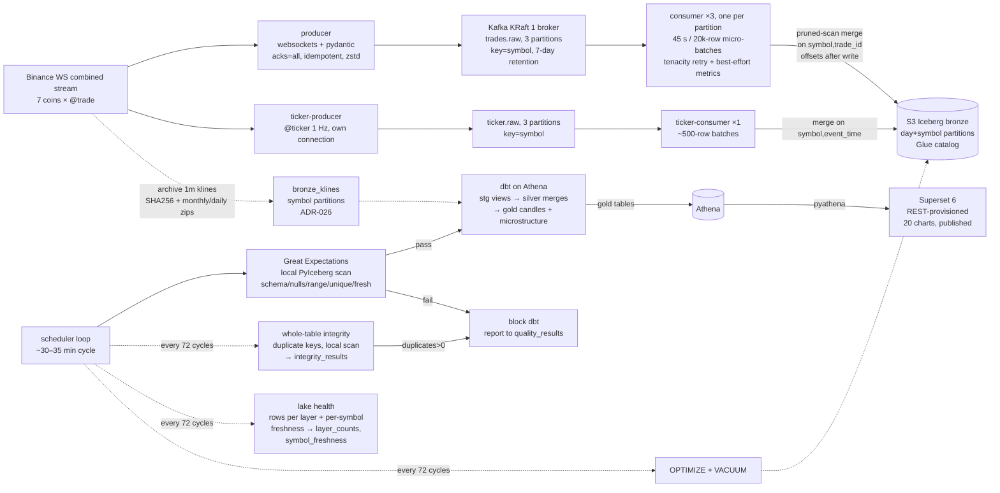

# Architecture

[Data flow](#data-flow) · [Delivery semantics](#delivery-semantics) ·
[Failure modes](#failure-modes-seen-in-practice-and-the-fixes)

## Data flow

1. **Produce.** One asyncio producer holds the Binance combined stream
   (`<coin>@trade` × 7, lowercase) on the market-data mirror, validates each
   payload with pydantic (`TradeEvent`: symbol, trade_id, Decimal price/qty,
   UTC event + ingest time, buyer-maker flag), stamps ingest time, and produces
   with `acks=all`, idempotence, zstd, keyed by symbol. Reconnects with
   exponential backoff + jitter; SIGTERM flushes.
2. **Consume.** Three consumer replicas (`bronze-writer` group, manual commits,
   earliest) — one per `trades.raw` partition, keyed by symbol so each symbol is
   owned by exactly one replica. Each batches 45 s / 20k rows, converts to
   Arrow, merges, appends, then commits offsets. The next batch window starts
   *after the whole flush* — write, commit and the best-effort metrics append —
   so a slow step cannot leave the next window expired (ADR-014/030). Lag,
   batch size and freshness are logged per cycle and appended to
   `tickstream.pipeline_metrics` after the commit (gap-not-dup).
3. **Bronze.** Raw trade facts, partitioned by day + symbol, format v2. Merge =
   scan the batch's day×symbol scope (manifest pruning), Arrow anti-join on
   `(symbol, trade_id)`, append new rows only; full replays append nothing.
4. **Quality.** GX checkpoint over `last_success − 5 min overlap` window:
   required columns, no nulls in keys, `price/qty > 0`, `symbol:trade_id`
   uniqueness, freshness ≤ 300 s, row count ≥ 1. JSON report to
   `quality/reports/` + row to `tickstream.quality_results`. Failure → nonzero
   exit → scheduler skips dbt (and doesn't advance the window). On maintenance
   cycles (`MAINTENANCE_EVERY_N_RUNS=72`, ~1.5–2 days) the scheduler also runs a
   **whole-table** integrity check (ADR-016): a local scan of the key columns
   only, `duplicates = rows − distinct_keys`, recorded in
   `tickstream.integrity_results`; any duplicate blocks dbt. The same cycle
   appends **lake health** (ADR-021): per-layer row counts + per-symbol freshness
   to `layer_counts` / `symbol_freshness`.
5. **Models.** dbt on Athena engine v3: `stg_trades` view → `silver_trades`
   (dedup `row_number()`, 2 h lookback, `update_condition` so identical rows
   skip rewrites) → `gold_candles_1m` (OHLC/volume/USD-notional/VWAP/trade_count/
   volatility, 30-min recompute) → `gold_market_summary_daily`/`_hourly`
   (per-symbol open/close/range/notional/%change from a shared macro) →
   `dim_symbol`/`dim_time` views (ADR-019). Archive klines run in parallel:
   `stg_klines` → `silver_klines` → `gold_candles_1m_hist` (volatility NULL) and
   the `gold_candles_1m_unified` view (live candle wins per minute, ADR-026).
   The ticker chain runs alongside: `stg_tickers` → `silver_tickers` →
   `gold_market_microstructure_1m` (spread/mid/depth/imbalance, ADR-029).
   128 dbt nodes (14 models + 114 data tests), all columns documented.
6. **Serve.** Superset 6 (derived image + `pyathena[pandas]`, SQLite metadata on
   a volume) provisioned by a REST script: Athena database, 10 datasets
   (gold, unified gold, microstructure + 2 business summaries + 5 ops/health
   tables, never bronze), 20 charts across two native tabs — **Market**
   (candlestick OHLC, price/VWAP, base volume, USD notional, trades/min,
   volatility, quoted spread, book imbalance, notional-share treemap, 2 KPI
   tiles, daily & hourly summary tables) and **Pipeline health** (lag, batch
   rows, quality runs, bronze integrity, rows per layer, per-symbol freshness).
   Native **Symbol** (defaults to the first configured coin, BTC) and **Time
   range** filters (ADR-020/027); 24 h detail + 30 d trend windows (ADR-022/027);
   all charts/labels defined in code (ADR-018). One published dashboard.
7. **Tickers.** A dedicated producer polls `@ticker` for each symbol at 1 Hz
   into `ticker.raw`; one consumer merges into `bronze_tickers` on
   `(symbol, event_time)`, the GX gate validates it, and dbt builds the 1-minute
   microstructure model (ADR-029).
8. **Backfill.** `make backfill` downloads Binance's monthly (complete months)
   and daily (partial month) 1m kline zips, verifies each SHA256 sidecar,
   normalises microsecond timestamps to naive UTC, and replaces `bronze_klines`
   in one commit (ADR-026). It is offline, idempotent (`--force`) and gated by
   dbt tests (uniqueness, OHLC/volume bounds), not the live GX window.
9. **Maintain.** Every 72 scheduler cycles (and via `make maintenance`): Athena
   `OPTIMIZE … REWRITE DATA USING BIN_PACK` + `VACUUM` on the Iceberg tables.
   Because a cycle takes ~30–35 min, this is ~1.5–2 days, not hourly.

## Delivery semantics

At-least-once from Kafka; idempotency at every layer: bronze merge keys,
silver `row_number()` + merge keys, gold candle keys, MERGE
`update_condition`s. Offsets commit only after the Iceberg write; a crash
replays into upserts/appends that absorb duplicates (verified: restart,
SIGKILL, 20k replay batch → 2 appended / 19,998 skipped).

## Failure modes seen in practice (and the fixes)

Full diagnosis and recovery steps are in the [runbook](runbook.md).

| Symptom | Root cause | Fix |
|---|---|---|
| S3 socket timeouts; crash/rebalance livelock | Short pyarrow S3 timeouts on a degraded network | Transient-only tenacity retry; 15/60 s timeouts; `max.poll.interval.ms` 10 min |
| 440k-message lag, one partition hot | Kafka murmur2 sent 6 of 7 symbols to partition 0 (BTC+ETH ≈ 74%) | Explicit symbol→partition map; no topic change or offset reset (ADR-028) |
| 15.8k duplicate keys after rebalance | Each replica cached its own Iceberg handle and replayed another replica's batch | `refresh()` before anti-join, cooperative-sticky, commit-on-revoke; integrity backstop (ADR-015/016) |
| One-row batches forever, lag unbounded | Window reset at flush start (ADR-014), then before a ~40 s metrics append (ADR-030) | Reset at the end of `_flush()`; verified live. Batcher tests cover window semantics, not caller ordering |
| Stream open but no trades for hours | Pings worked; per-message silence was invisible | 60 s per-message watchdog (ADR-025) |
| Four-day gap, ~1M backlog | Host sleep stopped Docker and the single broker; volume survived | Drain at ~20k/batch; backfill klines T+1; ticker history is unrecoverable |
| Glue `UpdateTable` timeouts on MERGE | Rewrote unchanged rows on every lookback | `update_condition` on immutable events (ADR-009) |
| `table.upsert` O(table) per batch | Full-table merge on every micro-batch | Pruned-scan anti-join merge (ADR-013); benchmark at 10× early |
| Superset 500s / login or catalog errors | IAM gaps, lowercase `awsdatacatalog`, Superset 6 config/JWT quirks | Add scoped IAM actions; pin `AwsDataCatalog`; config module + CSRF cookie/header (ADR-011/012) |
| `OPTIMIZE pipeline_metrics` commit error | Four consumers append while maintenance commits | Retry in a quiet window; `VACUUM` still succeeds, data unaffected |

## Repository layout

| Path | Contents |
|---|---|
| `src/pipeline/producer`, `consumer` | Binance WebSocket producers and Kafka→Iceberg consumers |
| `src/pipeline/common` | Typed settings/models, Iceberg catalog and ops-table helpers |
| `src/pipeline/quality`, `scheduler` | GX/integrity/health checks and the quality → dbt → maintenance loop |
| `src/pipeline/backfill`, `superset` | Archive kline loader and REST dashboard provisioning |
| `dbt/models/{staging,silver,gold}` | Typed views, incremental silver/gold models, tests and column docs |
| `quality/suites` | Great Expectations suite snapshots (reports are gitignored) |
| `infra`, `superset/` | OpenTofu resources and the derived Superset image/config |
| `tests/unit`, `tests/integration` | Offline pytest suite and the opt-in Kafka roundtrip |
| `docs`, `plan.md`, `Brief.md` | Reference docs, ADRs, historical plan and original requirements |
