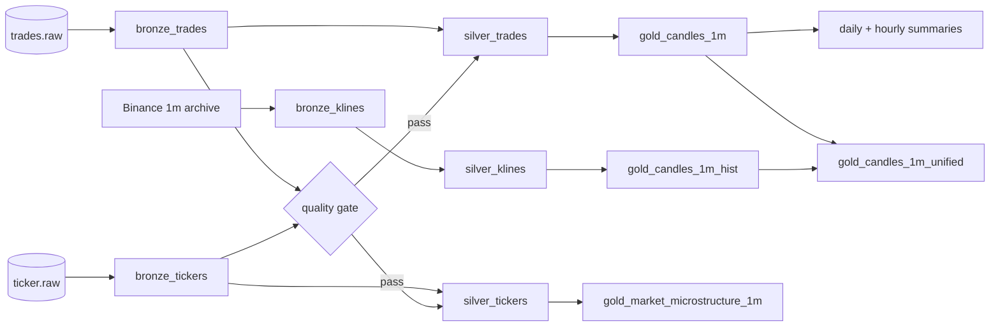

# Data model

**What this answers:** what each table contains, how rows are identified, how
queries stay cheap, and how long data is kept.

The project uses three refinement levels:

| Layer | Plain meaning | Rule |
|---|---|---|
| **Bronze** | Raw facts as they arrived, plus the stream archive | No business enrichment; replay-safe keys |
| **Silver** | Clean, typed, deduplicated rows | One row per key; UTC timestamps |
| **Gold** | Minute-level answers for charts and summaries | Incremental, tested, documented |

All timestamps are UTC. Iceberg stores naive UTC timestamps (no timezone suffix).
Every trade keeps both **event time** (when Binance matched it) and **ingest time**
(when our producer received it). Terms are defined in the
[glossary](glossary.md).

## Lineage



`gold_candles_1m_unified` is the chart series: a live candle wins when both a live
and an archive row exist for the same minute. The full flow is in the
[architecture](architecture.md#one-trades-journey).

## Bronze — raw and replay-safe

| Table | One row per | Key | Partition | Notes |
|---|---|---|---|---|
| `bronze_trades` | Trade | `(symbol, trade_id)` | `day(event_time)`, `symbol` | Live Binance trades. No enrichment. The writer appends only keys not already present, so a replay adds nothing. |
| `bronze_tickers` | 1 Hz quote snapshot | `(symbol, event_time)` | `day(event_time)`, `symbol` | Best bid/ask, sizes, last trade, rolling 24 h stats. Not reconstructable from Binance history. |
| `bronze_klines` | 1-minute archive candle | `(symbol, open_time)` | `symbol` | OHLCV from Binance's archive. `make backfill FORCE=1` replaces the table in one commit. T+1 only. |

“Raw” means the trade facts are not enriched or changed. The write-time merge is
only a duplicate-absorbing commit, not a business transformation.

### Core bronze fields

| Field | Meaning |
|---|---|
| `symbol` | Trading pair, for example `BTCUSDT` |
| `trade_id` / `event_time` | Exchange identifier and event time |
| `price`, `quantity` | Execution price and base-asset quantity |
| `ingest_time` | When the producer received the event |
| `is_buyer_maker` | Whether the buyer was the resting maker |

`bronze_tickers` adds `bid_price`, `bid_quantity`, `ask_price`, `ask_quantity`,
`last_price`, `last_quantity`, and rolling 24-hour open/high/low/volume/quote
volume/trade count.

`bronze_klines` adds `open`, `high`, `low`, `close`, `volume`, `quote_volume`,
`trade_count`, taker-buy volumes, `source`, and its own `ingest_time`.

## Silver — typed and deduplicated

| Table | Key | How it is built | Notes |
|---|---|---|---|
| `silver_trades` | `(symbol, trade_id)` | Incremental merge, `day(event_time)` + `symbol` | Deduplicates with `row_number()`; two-hour late-arrival lookback; unchanged rows are not rewritten. |
| `silver_tickers` | `(symbol, event_time)` | Incremental merge, `day(event_time)` + `symbol` | Same lookback and immutable-row guard. |
| `silver_klines` | `(symbol, open_time)` | View | Cleans and deduplicates the static archive; no incremental state. |

Silver is defence in depth: even if a duplicate reaches bronze, it should not
reach gold.

## Gold — modelling and serving

| Table | One row per | Key | How it is built | Notes |
|---|---|---|---|---|
| `gold_candles_1m` | Symbol + minute | `(symbol, candle_start)` | Incremental merge, `day(candle_start)` + `symbol` | OHLC, volume, notional, VWAP, trade count, volatility; 30-minute recompute. Volatility is NULL for a single-trade minute. |
| `gold_market_summary_daily` | Symbol + day | `(symbol, window_start)` | Incremental merge, `day(window_start)` + `symbol` | Open/close, high/low, notional, volume, trade count, trades/min, % change; two-day recompute. |
| `gold_market_summary_hourly` | Symbol + hour | `(symbol, window_start)` | Incremental merge, `day(window_start)` + `symbol` | Same measures at hour grain; two-hour recompute. |
| `gold_market_microstructure_1m` | Symbol + minute | `(symbol, window_start)` | Incremental merge, `day(window_start)` + `symbol` | Average spread (bps), mid, displayed bid/ask depth, imbalance, last price, snapshot count; 30-minute recompute. |
| `gold_candles_1m_hist` | Symbol + minute | `(symbol, candle_start)` | View | Archive candles; volatility NULL; `source = 'kline'`. |
| `gold_candles_1m_unified` | Symbol + minute | `(symbol, candle_start)` | View | `source = 'live'` or `'kline'`; live wins when both exist. |
| `dim_symbol` | Symbol | `symbol` | View | Base/quote assets and first/last seen. |
| `dim_time` | Minute | `minute_start` | View | Hour/day/weekday/hour-of-day attributes for grouping. |

### Core gold fields

| Field | Meaning |
|---|---|
| `open`, `high`, `low`, `close` | First, highest, lowest, and last trade price in the bucket |
| `volume` | Base-asset quantity traded |
| `notional` | USD value traded: `sum(price × quantity)` |
| `vwap` | Volume-weighted average price: `notional ÷ volume` |
| `trade_count` | Number of trades in the bucket |
| `trades_per_min` | `sum(trade_count) ÷ count(minutes present)` in the summary bucket |
| `change_pct` | `(close − open) ÷ open` |
| `volatility` | Standard deviation of per-trade log returns; live candles only |
| `avg_spread_bps` | Average relative spread, `(ask − bid) ÷ mid × 10,000`, in basis points |
| `avg_mid` | Average midpoint of best bid and best ask |
| `avg_bid_qty`, `avg_ask_qty` | Average displayed size at the top of the book |
| `avg_imbalance` | `(bid_qty − ask_qty) ÷ (bid_qty + ask_qty)`, in `[-1, 1]` |
| `tick_count` | Quote snapshots aggregated into the minute |

The live gold models are incremental and **target-anchored**: the next run starts from the
newest minute already in the gold table, not from the newest source row. A late
trade therefore recomputes the affected minute instead of appending a second
version. See [ADR-024](decisions.md#adr-024--incremental-windows-anchor-on-the-target-with-overridable-lookbacks).

A full refresh is a deliberate reconciliation step, not part of the normal loop.

## Operations tables

Append-only, unpartitioned Iceberg tables in the same Glue database. They record
observability, not business facts. Metrics append after the offset commit, so a
crash may lose one row but replay does not duplicate it ([ADR-008](decisions.md#adr-008--ops-tables-live-in-the-tickstream-glue-database)).

| Table | One row per | Main columns |
|---|---|---|
| `quality_results` | GX run | `check_at`, `success`, window, rows scanned, failed expectations, duration |
| `pipeline_metrics` | Consumer micro-batch | `collected_at`, `rows`, `max_event_time`, `lag_messages`, `commit_ms` |
| `integrity_results` | Whole-table check | `checked_at`, table, total rows, distinct keys, duplicates, duration |
| `layer_counts` | Layer per health check | `collected_at`, `layer`, `row_count` |
| `symbol_freshness` | Symbol per health check | `collected_at`, `symbol`, `max_event_time`, `freshness_seconds` |

## Keys and partitions

- **Trade key:** `(symbol, trade_id)`. Binance trade IDs are unique per symbol,
  not globally.
- **Quote key:** `(symbol, event_time)`.
- **Candle key:** `(symbol, candle_start)`.
- **Kline key:** `(symbol, open_time)`.
- **Kafka:** three partitions per topic, keyed by symbol. Each symbol lands on one
  partition, so one consumer owns it and order is preserved.
- **Iceberg partitions:** event day and symbol for live tables. Archive klines use
  symbol only. A query that filters day and symbol lets Athena skip unrelated
  files.

## Example queries

Latest BTC candles for the last 24 hours:

```sql
SELECT candle_start, open, high, low, close, volume, vwap, source
FROM tickstream.gold_candles_1m_unified
WHERE symbol = 'BTCUSDT'
  AND candle_start >= now() - interval '24' hour
ORDER BY candle_start DESC;
```

Freshness by symbol from the latest health check:

```sql
SELECT symbol, max_event_time, freshness_seconds
FROM tickstream.symbol_freshness
WHERE collected_at = (SELECT max(collected_at) FROM tickstream.symbol_freshness)
ORDER BY freshness_seconds DESC;
```

Duplicate-key count in bronze (0 is expected; this is the slow whole-table check):

```sql
SELECT count(*) AS rows,
       count(DISTINCT symbol || '#' || CAST(trade_id AS varchar)) AS keys,
       count(*) - count(DISTINCT symbol || '#' || CAST(trade_id AS varchar)) AS duplicates
FROM tickstream.bronze_trades;
```

## Retention and cleanup

- **Kafka:** seven days. Older messages cannot be replayed.
- **Iceberg:** no automatic table TTL yet. `OPTIMIZE` merges small files;
  `VACUUM` removes old snapshots and manifests. S3 expiration and tiering rules
  are still a recommendation in [cost](cost.md).
- **Archive:** T+1. The current UTC day is live-only until the next daily file.
- **Operations tables:** append-only; not yet pruned. They grow slowly.

Compaction matters because many 45-second commits create many small S3 objects.
The bill is driven more by request count than by stored bytes.
