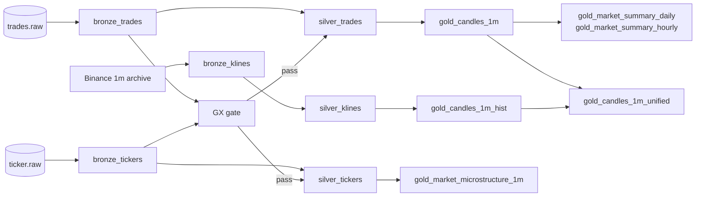

# Data model

A medallion lake: raw events in bronze, deduped/typed rows in silver, and
minute-level analytics in gold. All timestamps are UTC; Iceberg stores naive UTC
timestamps, and both event time and ingest time are retained.

## Lineage

`gold_candles_1m_unified` is the chart series: live candles win per minute,
archive klines fill the rest. The full flow is in
[architecture](architecture.md).

## Tables

### Bronze — raw and append-only

| Table | Grain / key | Partition | Notes |
|---|---|---|---|
| `bronze_trades` | one row per trade; `(symbol, trade_id)` | `day(event_time)`, `symbol` | Live Binance trades. No enrichment. The writer anti-joins the batch scope before appending, so replays add nothing. |
| `bronze_tickers` | one row per 1 Hz snapshot; `(symbol, event_time)` | `day(event_time)`, `symbol` | Top-of-book plus rolling 24 h stats. Not reconstructable from Binance history. |
| `bronze_klines` | one row per minute; `(symbol, open_time)` | `symbol` | Archive OHLCV, loaded by `make backfill`. `FORCE=1` replaces the whole table in one commit. T+1 only. |

Bronze is "raw" in the sense that trade facts are not enriched or mutated.
Idempotency is a dedup-commit during the write, not an update to the source data.

### Silver — deduped and typed

| Table | Grain / key | Materialization | Notes |
|---|---|---|---|
| `silver_trades` | `(symbol, trade_id)` | incremental MERGE, `day(event_time)` + `symbol` | Dedupes with `row_number()`; 2 h late-arrival lookback; `update_condition` skips identical rows. |
| `silver_tickers` | `(symbol, event_time)` | incremental MERGE, `day(event_time)` + `symbol` | Same 2 h lookback and immutable-row guard. |
| `silver_klines` | `(symbol, open_time)` | view | Cleans/dedupes the static archive; no incremental state. |

Silver is defence in depth: even a duplicate that reaches bronze should not reach
gold.

### Gold — models and serving views

| Table | Grain / key | Materialization | Notes |
|---|---|---|---|
| `gold_candles_1m` | `(symbol, candle_start)` | incremental MERGE, `day(candle_start)` + `symbol` | OHLC, volume, notional, VWAP, trade count, volatility; 30 min recompute. Volatility is NULL for single-trade minutes. |
| `gold_market_summary_daily` | `(symbol, window_start)` | incremental MERGE, `day(window_start)` + `symbol` | Open/close, high/low, notional, volume, trade count, trades/min, % change; 2 day recompute. |
| `gold_market_summary_hourly` | `(symbol, window_start)` | incremental MERGE, `day(window_start)` + `symbol` | Same measures at hour grain; 2 hour recompute. |
| `gold_market_microstructure_1m` | `(symbol, window_start)` | incremental MERGE, `day(window_start)` + `symbol` | Quoted spread (bps), mid, displayed bid/ask depth, imbalance, last price, snapshot count; 30 min recompute. |
| `gold_candles_1m_hist` | per minute | view | Archive candles; `volatility` is NULL; `source = 'kline'`. |
| `gold_candles_1m_unified` | `(symbol, candle_start)` | view | `source` is `live` or `kline`; live wins when both exist. |
| `dim_symbol` | one row per symbol | view | Base/quote assets and first/last seen. |
| `dim_time` | one minute per row | view | Hour/day/weekday attributes for chart grouping. |

Gold models are incremental and target-anchored: a late trade recomputes the
affected minute/window instead of appending a second version
([ADR-024](decisions.md#adr-024--incremental-windows-anchor-on-the-target-with-overridable-lookbacks)).
A full refresh is a deliberate reconciliation step, not part of the normal loop.

## Operations tables

Append-only, unpartitioned Iceberg tables in the same Glue database
([ADR-008](decisions.md#adr-008--ops-tables-live-in-the-tickstream-glue-database)).
They record observability, not business facts; replayed metrics rows are
possible and acceptable.

| Table | One row per | Main columns |
|---|---|---|
| `quality_results` | GX run | `check_at`, `success`, window, rows scanned, failed expectations, duration |
| `pipeline_metrics` | consumer micro-batch | `collected_at`, `rows`, `max_event_time`, `lag_messages`, `commit_ms` |
| `integrity_results` | whole-table check | `checked_at`, table, total rows, distinct keys, duplicates, duration |
| `layer_counts` | layer per health check | `collected_at`, `layer`, `row_count` |
| `symbol_freshness` | symbol per health check | `collected_at`, `symbol`, `max_event_time`, `freshness_seconds` |

## Keys and retention

- **Idempotency keys:** trades `(symbol, trade_id)`, tickers
  `(symbol, event_time)`, klines `(symbol, open_time)`, candles
  `(symbol, candle_start)`.
- **Kafka:** 3 partitions per topic, symbol keys, **7 day retention**. The
  explicit symbol-to-partition map is in
  [ADR-028](decisions.md#adr-028--explicit-symbolpartition-routing-for-tradesraw).
- **Iceberg:** no automatic table TTL yet. `OPTIMIZE` compacts files and
  `VACUUM` removes old snapshots/manifests; S3 lifecycle rules are still a
  recommendation in [cost](cost.md).
- **Backfill:** the kline archive is T+1. The current UTC day is live-only until
  the next daily archive.
